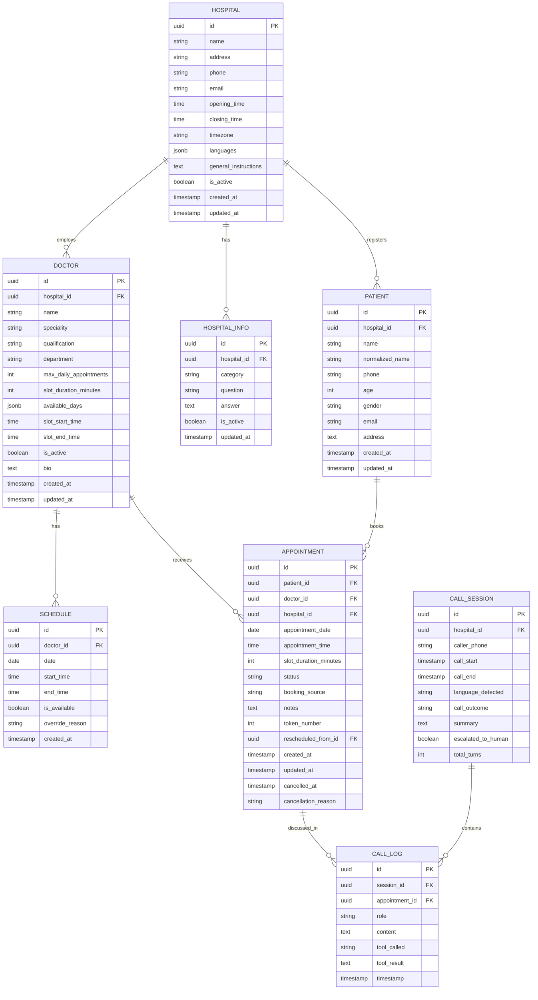
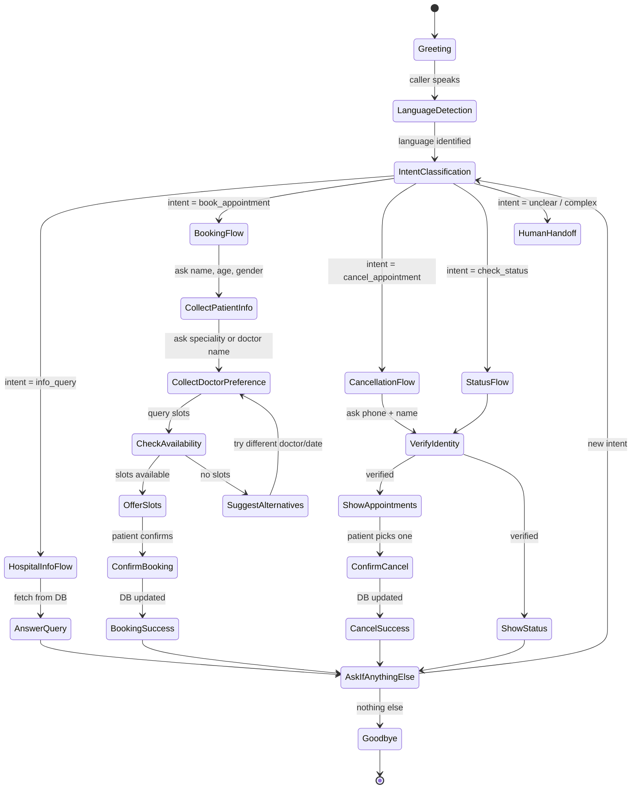

# MedNexa — Agentic AI Hospital Receptionist

## Implementation Plan (5-Part Division)

---

## 0. Executive Summary

**MedNexa** is a voice-enabled, agentic AI receptionist that answers hospital phone calls, provides hospital/doctor information, and books or cancels patient appointments — all autonomously. Hospitals manage their data (doctors, schedules, general info) through a web admin dashboard, and the AI agent reads this data in real time to give accurate answers.

### Core Capabilities

| Capability | Details |
|---|---|
| **Voice Calls** | Picks up incoming calls via SIP/VoIP, converses naturally |
| **Bilingual** | Fluent English and Hindi (auto-detect + switch mid-call) |
| **Appointment Booking** | Collects patient info, checks slot availability, books with conflict detection |
| **Appointment Cancellation** | Verifies caller identity, cancels confirmed bookings |
| **Status Inquiry** | Tells callers their own appointment status (after identity verification) |
| **Hospital Info** | Answers questions about address, OPD timings, departments, parking, etc. |
| **Multi-booking** | Same phone → different patients → parallel bookings allowed; same patient → different time-slots only |
| **Human Handoff** | Escalates to human staff when confidence is low (Phase 2) |

### High-Level Architecture

```
┌─────────────────────────────────────────────────────────────┐
│                    HOSPITAL LOCAL SERVER                     │
│                                                             │
│  ┌──────────┐   ┌──────────────┐   ┌───────────────────┐   │
│  │ Telephony│──▶│ AI Agent Core│──▶│  Database          │   │
│  │ Gateway  │◀──│ (LLM + Tools)│◀──│  (PostgreSQL 16)   │   │
│  │ (SIP/    │   └──────┬───────┘   └───────────────────┘   │
│  │  WebRTC) │          │                    ▲               │
│  └──────────┘   ┌──────▼───────┐            │               │
│                 │  STT Engine  │   ┌────────┴────────┐      │
│                 │  (Whisper)   │   │  Admin Dashboard │      │
│                 └──────────────┘   │  (Next.js / Web) │      │
│                 ┌──────────────┐   └─────────────────┘      │
│                 │  TTS Engine  │                             │
│                 │ (Piper/Edge) │                             │
│                 └──────────────┘                             │
└─────────────────────────────────────────────────────────────┘
```

---

## 1. Technology Stack

| Layer | Primary Choice | Fallback / Cloud Option | Rationale |
|---|---|---|---|
| **Language** | Python 3.11+ | — | Rich AI/ML ecosystem, async support |
| **Web Framework** | FastAPI | — | Async, OpenAPI docs, WebSocket support |
| **Database** | PostgreSQL 16 (dev + prod, via Docker) | — | Row locks, partial indexes, JSONB; dev matches prod so concurrency is testable |
| **ORM** | SQLAlchemy 2.0 + Alembic | — | Async support, migration management |
| **LLM (Local)** | Ollama + `llama3.1:8b` or `mistral-nemo:12b` | Groq API (free tier) / OpenAI | Runs on local GPU; fallback if too slow or hallucinating |
| **LLM Framework** | LangGraph (tool-calling agent) | LangChain fallback | Stateful, graph-based agent with tool use |
| **STT** | Faster-Whisper (local, CTranslate2) | Deepgram API / Google STT | Real-time, runs on CPU/GPU, Hindi+English |
| **TTS** | Piper TTS (local, ONNX) | Edge-TTS (free, Microsoft) / ElevenLabs | Fast, low-latency, Hindi+English voices |
| **Telephony** | Asterisk PBX + ARI | Twilio (cloud) | Local SIP trunk; Twilio for quick prototype |
| **Admin Dashboard** | Next.js 14 (App Router) | — | React-based, SSR, API routes |
| **Task Queue** | Celery + Redis | — | Background jobs (reminders, cleanup) |
| **Caching** | Redis | — | Session state, rate limiting |
| **Containerization** | Docker + Docker Compose | — | Reproducible local deployment |

### Local Model Strategy

```
┌─────────────────────────────────────────────────────────┐
│                    MODEL SELECTION LOGIC                  │
│                                                          │
│  1. Try LOCAL model first (Ollama)                        │
│     ├─ Response time < 3s? ──▶ USE LOCAL                 │
│     └─ Response time > 3s OR hallucination detected?     │
│           └─▶ Fallback to CLOUD API (Groq / OpenAI)     │
│                                                          │
│  2. Config flag: FORCE_LOCAL=true / FORCE_CLOUD=true     │
│  3. Per-task routing:                                    │
│     ├─ Simple slot queries ──▶ LOCAL (fast enough)       │
│     ├─ Complex conversations ──▶ LOCAL or CLOUD          │
│     └─ Hindi conversations ──▶ CLOUD (better quality)   │
└─────────────────────────────────────────────────────────┘
```

**LLM Abstraction Layer**: We build a `ModelRouter` class that:
- Wraps both local (Ollama) and cloud (Groq/OpenAI) providers behind a unified interface
- Measures latency per call and logs it
- Has a circuit-breaker: if local fails 3x in a row, auto-switch to cloud for N minutes
- Configurable via `config.yaml` — hospital admin can choose preferred mode

---

## 2. Database Schema Design

### How the AI Handles the Database

> [!IMPORTANT]
> The AI agent does **NOT** write raw SQL. Instead, it calls **Python tool functions** that are registered with the LangGraph agent. Each tool is a thin wrapper around a **Part 1 service function** (`app/services/contracts.py`); all validation, conflict checks and transaction safety live in the service layer, which the admin API uses too.

```
AI Agent (LLM)
    │
    ├── calls tool: "check_available_slots(doctor_id, date)"
    │       └── slot_service → weekly template + date override − booked − past slots → returns JSON
    │
    ├── calls tool: "book_appointment(patient_name, phone, age, gender, doctor_id, date, time)"
    │       └── appointment_service → lock doctor row (FOR UPDATE) → re-check slot + daily cap
    │           → upsert patient → assign token → INSERT → returns confirmation
    │
    ├── calls tool: "cancel_appointment(appointment_id, phone)"
    │       └── appointment_service → verifies phone ownership → status = CANCELLED → returns result
    │
    └── calls tool: "get_hospital_info(query)"
            └── hospital_service → search active hospital_info entries → returns matches
```

### Entity-Relationship Diagram



### Key Constraints & Business Rules

| Rule | Implementation |
|---|---|
| Same phone, different patient names → allowed parallel bookings | Patient identity is `UNIQUE(hospital_id, phone, normalized_name)` — not phone alone |
| One doctor slot holds one patient | Partial unique index `(doctor_id, appointment_date, appointment_time) WHERE status='BOOKED'` |
| Same patient, same doctor, same time → blocked | Covered by the index above + app-level check in booking service |
| Same patient, different doctor, same time → allowed | No constraint across doctors for same patient |
| Same patient, same doctor, different time → allowed | Constraints permit this |
| Cancelled slot can be rebooked | All uniqueness rules are partial (`WHERE status='BOOKED'`) |
| Slot capacity | `COUNT(BOOKED) < doctor.max_daily_appointments` checked **inside the same transaction** as the INSERT, under a `FOR UPDATE` lock on the doctor row |
| Caller verification | Phone number match required to view/cancel; optionally OTP via SMS |
| Appointment status enum | `BOOKED`, `CANCELLED`, `COMPLETED`, `NO_SHOW`, `RESCHEDULED` |

---

## 3. AI Agent Architecture (LangGraph)

### Agent State Machine



### Tool Functions (AI's DB Interface)

```python
# These are the tools the LLM agent can invoke via LangGraph tool-calling.
# Each one wraps a Part 1 service in app/services/contracts.py. hospital_id and
# caller_phone come from the call state, never from the LLM. Domain exceptions
# (SlotUnavailable, DailyCapReached, DuplicateBooking, NotOwner, ...) are turned
# into short error dicts the LLM can explain to the caller.

@tool
def get_hospital_info(query: str) -> list[dict]:
    """Search hospital general information (address, timings, departments, parking, etc.)"""

@tool
def list_doctors(speciality: Optional[str] = None, department: Optional[str] = None) -> list[dict]:
    """List available doctors, optionally filtered by speciality or department."""

@tool
def get_doctor_details(doctor_id: str) -> dict:
    """Get full details of a specific doctor including weekly schedule."""

@tool
def check_available_slots(doctor_id: str, date: str) -> list[dict]:
    """Check available appointment slots for a doctor on a given date (past slots excluded)."""

@tool
def find_next_available(speciality: str, preferred_date: Optional[str] = None, limit: int = 5) -> list[dict]:
    """Find next available slots across all doctors of a given speciality."""

@tool
def book_appointment(
    patient_name: str, 
    patient_phone: str, 
    patient_age: int,
    patient_gender: str,
    doctor_id: str, 
    appointment_date: str, 
    appointment_time: str,
    notes: Optional[str] = None
) -> dict:
    """Book an appointment. Same phone + same name reuses the patient record.
    Returns confirmation with token number or error."""

@tool
def cancel_appointment(appointment_id: str, caller_phone: str, reason: Optional[str] = None) -> dict:
    """Cancel an appointment after verifying caller owns it via phone match."""

@tool
def reschedule_appointment(appointment_id: str, caller_phone: str, new_date: str, new_time: str) -> dict:
    """Move an appointment to a new slot (old one marked RESCHEDULED). Returns new confirmation."""

@tool
def get_patient_appointments(phone: str, patient_name: str) -> list[dict]:
    """Get appointments for a verified patient (phone + name must match)."""

@tool
def get_current_datetime() -> str:
    """Get the current date, time, and day of week."""
```

### System Prompt Structure

```
You are MedNexa, an AI receptionist for {hospital_name}.

HOSPITAL CONTEXT (auto-injected from DB):
- Address: {address}
- Timings: {opening_time} to {closing_time}
- Departments: {departments_list}
- Today's Date: {today}
- Current Time: {current_time}

ACTIVE DOCTORS TODAY:
{doctor_summaries_with_remaining_slots}

RULES:
1. Always be polite, professional, and concise.
2. Speak in the language the caller uses (English or Hindi). If uncertain, ask.
3. For booking: collect patient name, phone, age, gender, preferred doctor/speciality, preferred date/time.
4. For cancellation: verify caller by asking phone number + patient name before showing appointments.
5. NEVER reveal other patients' information.
6. If a slot is full, suggest the next available slot or an alternative doctor.
7. For questions you cannot answer, say you'll connect them with hospital staff.
8. Always confirm details before finalizing a booking or cancellation.
9. One call can handle multiple requests (book + cancel + info query).
```

---

## 4. Call Flow Pipeline

```
                     INCOMING CALL
                          │
                          ▼
                ┌─────────────────┐
                │   Asterisk PBX  │  (or Twilio webhook)
                │   answers call  │
                └────────┬────────┘
                         │ Audio stream (16kHz PCM)
                         ▼
                ┌─────────────────┐
                │  VAD (Silero)   │  Voice Activity Detection
                │  Detects speech │  — segments audio into utterances
                └────────┬────────┘
                         │ Audio chunks
                         ▼
                ┌─────────────────┐
                │  STT Engine     │  Faster-Whisper (local)
                │  Audio → Text   │  Model: large-v3 (multilingual)
                │                 │  Streaming mode for low latency
                └────────┬────────┘
                         │ Transcribed text + language tag
                         ▼
                ┌─────────────────┐
                │  AI Agent       │  LangGraph agent
                │  (LLM + Tools)  │  Processes text → calls tools → generates response
                │                 │  Maintains conversation state in memory
                └────────┬────────┘
                         │ Response text
                         ▼
                ┌─────────────────┐
                │  TTS Engine     │  Piper TTS (local) or Edge-TTS
                │  Text → Audio   │  Voice: Hindi female / English female
                │                 │  Streams audio back
                └────────┬────────┘
                         │ Audio stream
                         ▼
                ┌─────────────────┐
                │  Asterisk PBX   │  Plays audio to caller
                │  sends audio    │
                └─────────────────┘
```

### Latency Budget (Target: < 2s end-to-end)

| Stage | Target | Optimization |
|---|---|---|
| VAD | 50ms | Silero VAD — lightweight |
| STT | 300-500ms | Faster-Whisper with `beam_size=1`, FP16 |
| LLM | 500-1000ms | Local: quantized model; Cloud: Groq (fastest) |
| Tool execution | 50-100ms | Indexed PostgreSQL queries + async connection pool |
| TTS | 200-300ms | Piper ONNX, stream first chunk |
| **Total** | **~1.5-2s** | Pipelining: start TTS before full LLM response |

---

## 5. Five-Part Team Division

---

### PART 1 — Database, Models & API Layer
**Owner: Team Member 1 (Backend/DB Engineer)**

#### Scope
Everything related to data persistence, schema, migrations, the service layer (which Part 2's agent tools wrap), and the REST API (which Part 4's dashboard consumes).

> [!IMPORTANT]
> **Build order matters more than speed.** Part 2 depends on the *service function signatures*, and Part 4 depends on the *API contract*. Both are published on Day 1 (as stubs if needed), before the logic is finished, so nobody is blocked.

#### Locked Design Decisions (decide on Day 0 — do not revisit mid-build)

| # | Decision | Why |
|---|---|---|
| D1 | **PostgreSQL 16 in Docker for dev *and* prod** — no SQLite | `SELECT FOR UPDATE`, partial indexes and `JSONB` behave differently (or not at all) on SQLite; concurrency can't be tested on it |
| D2 | **Doctor fields = weekly template; `SCHEDULE` rows = per-date overrides only** (leave, changed hours) | Avoids creating a schedule row for every day; a missing row means "use the template" |
| D3 | **All uniqueness rules are partial indexes `WHERE status = 'BOOKED'`** | Cancelled rows must not block rebooking the same slot |
| D4 | **One slot = one patient**: `UNIQUE(doctor_id, appointment_date, appointment_time) WHERE status='BOOKED'` | The original schema allowed two patients in the same doctor slot |
| D5 | **Booking serialises on the doctor row** (`SELECT … FROM doctor WHERE id=:id FOR UPDATE`), then checks the daily cap, assigns the token and inserts in the **same transaction**; the unique index is the final safety net (`IntegrityError` → `SlotUnavailable`) | Checking the cap and inserting separately is a race; one row lock per doctor is simple and plenty for hospital-scale traffic |
| D6 | **Token number = per-doctor, per-day integer sequence**, assigned under the D5 lock; `UNIQUE(doctor_id, appointment_date, token_number)` | Deterministic, short enough to read out on a call |
| D7 | **Time handling**: `created_at`/`updated_at` etc. are `timestamptz` (UTC); `appointment_date` + `appointment_time` are **hospital-local wall-clock**; `hospital.timezone` (default `Asia/Kolkata`) is used for "today" and "slot already passed" checks | Appointments are local events; this prevents offering slots that have already passed |
| D8 | **Patient identity = `(hospital_id, phone, normalized_name)`**, unique; `normalized_name` = lower-cased, whitespace-collapsed | Same phone + different name → different patient (the multi-booking rule); same phone + same name → reuse the record |
| D9 | **List columns (`languages`, `available_days`) are `JSONB`**; `available_days` stores ISO weekday ints `[1..7]` | Portable, easy to query |
| D10 | **Auth is a pluggable dependency** (`app/api/deps.py::require_staff`), a no-op stub until Part 5 delivers JWT | Part 1 isn't blocked on 5.3, and routes don't change later |
| D11 | **Service layer is the only path to the DB**: API routes and agent tools both call `services/*`, never the ORM directly | Business rules live in exactly one place |

#### Schema changes vs §2 ERD

| Table | Change |
|---|---|
| `hospital` | + `timezone` (default `Asia/Kolkata`); `languages` → `JSONB` |
| `doctor` | `available_days` → `JSONB` weekday ints; `CHECK (slot_duration_minutes > 0)`, `CHECK (slot_end_time > slot_start_time)` |
| `schedule` | `UNIQUE(doctor_id, date)` — at most one override per doctor per day; `start_time`/`end_time` nullable (null = use template) |
| `patient` | + `hospital_id` FK, + `normalized_name`; `UNIQUE(hospital_id, phone, normalized_name)`; index on `phone` |
| `appointment` | `token_number` → `int`; + `rescheduled_from_id` (self FK); `status` as a PG enum; partial unique indexes from D3/D4 + `UNIQUE(doctor_id, appointment_date, token_number)`; indexes on `(doctor_id, appointment_date)` and `(patient_id)` |
| `call_session` / `call_log` | index on `call_log.session_id`, `call_session.caller_phone`; `call_log.appointment_id` nullable |

#### Deliverables (in build order)

Estimates assume Claude Code. **Opus 5.5** is used where a subtle bug would be costly; **Sonnet 5.5** for boilerplate.

| # | Task | Priority | Model | Est. (hrs) |
|---|---|---|---|---|
| **M1 — Foundations & contracts (Day 1)** | | | | |
| 1.1 | Project setup: `uv`, FastAPI, pydantic-settings, async engine + session dependency + pool config, `docker-compose.dev.yml` (Postgres), ruff + mypy + pytest config | P0 | Sonnet | 1 |
| 1.2 | SQLAlchemy 2.0 models + enums + all constraints/indexes above | P0 | Opus | 1.5 |
| 1.3 | Alembic async `env.py` + initial migration (verify the partial indexes in the generated SQL) | P0 | Sonnet | 0.5 |
| 1.4 | **Service contract**: typed signatures + Pydantic DTOs + domain exceptions for every service function (bodies may be `NotImplementedError`) → **hand to Part 2** | P0 | Opus | 1 |
| 1.5 | Seed script (1 hospital, ~6 doctors across 3 departments, overrides, FAQ entries, some bookings) | P0 | Sonnet | 0.5 |
| **M2 — Core engine (Day 2)** | | | | |
| 1.6 | Slot availability engine (template + override, past-slot filtering in the hospital timezone, daily cap, `find_next_available` across a speciality) | P0 | Opus | 2.5 |
| 1.7 | Booking service: book / cancel (with phone-ownership check) / reschedule, patient upsert (D8), locking + tokens (D5, D6) | P0 | Opus | 3 |
| 1.8 | Business-rule + concurrency tests (N parallel bookings for the last slot → exactly 1 succeeds; cap enforcement; rebooking after a cancel) against real Postgres | P0 | Opus | 2 |
| **M3 — API surface (Day 3)** | | | | |
| 1.9 | CRUD routes: Hospital, Doctor, Schedule overrides, HospitalInfo (pagination, filters, soft delete via `is_active`) | P0 | Sonnet | 2 |
| 1.10 | Patient routes: create/update, search by phone, appointment history | P0 | Sonnet | 0.5 |
| 1.11 | Appointment routes: book, cancel, reschedule, list with filters (date, doctor, status), slot query endpoints | P0 | Sonnet | 1 |
| 1.12 | Call session + call log routes (start, append turn, end with outcome/summary, list/detail) | P1 | Sonnet | 1 |
| **M4 — Hardening (Day 4)** | | | | |
| 1.13 | Error mapping (domain exceptions → structured HTTP errors), `require_staff` stub (D10), `/health` with DB check, OpenAPI tags/examples | P0 | Sonnet | 1 |
| 1.14 | API tests (httpx `AsyncClient`) for every route + coverage ≥ 80% + CI-ready `pytest` run | P0 | Sonnet | 2 |
| | **Total** | | | **~19.5 h ≈ 4 days** |

> [!TIP]
> The original estimate was 13 days. The saving comes from code generation; **the remaining time is mostly review and running tests**. Don't skip reading the code in 1.2, 1.6 and 1.7 — that's where the bugs that matter would be.

#### Service Contract (shared with Part 2)

```python
# app/services/contracts.py — Part 2's @tool functions wrap exactly these
async def get_hospital_info(db, hospital_id: UUID, query: str) -> list[HospitalInfoOut]: ...
async def list_doctors(db, hospital_id: UUID, speciality: str | None = None,
                       department: str | None = None) -> list[DoctorOut]: ...
async def get_doctor(db, doctor_id: UUID) -> DoctorDetailOut: ...
async def get_available_slots(db, doctor_id: UUID, on: date) -> list[SlotOut]: ...
async def find_next_available(db, hospital_id: UUID, speciality: str,
                              from_date: date | None = None, limit: int = 5) -> list[DoctorSlotOut]: ...
async def book_appointment(db, req: BookingRequest) -> BookingConfirmation: ...   # raises SlotUnavailable, DailyCapReached, DuplicateBooking, InvalidSlot
async def cancel_appointment(db, appointment_id: UUID, caller_phone: str,
                             reason: str | None = None) -> AppointmentOut: ...    # raises NotFound, NotOwner, NotCancellable
async def reschedule_appointment(db, appointment_id: UUID, caller_phone: str,
                                 new_date: date, new_time: time) -> BookingConfirmation: ...
async def get_patient_appointments(db, hospital_id: UUID, phone: str,
                                   patient_name: str, upcoming_only: bool = True) -> list[AppointmentOut]: ...
```

#### Key Algorithms

```python
# Slot computation (D2, D7)
async def get_available_slots(db, doctor_id: UUID, on: date) -> list[SlotOut]:
    doctor = await db.get(Doctor, doctor_id)            # with hospital loaded
    if not doctor or not doctor.is_active:
        return []
    override = await get_schedule_override(db, doctor_id, on)

    if override:                                         # override wins
        if not override.is_available:
            return []
        start = override.start_time or doctor.slot_start_time
        end = override.end_time or doctor.slot_end_time
    elif on.isoweekday() in doctor.available_days:       # weekly template
        start, end = doctor.slot_start_time, doctor.slot_end_time
    else:
        return []

    booked = await booked_times(db, doctor_id, on)       # status == BOOKED only
    if len(booked) >= doctor.max_daily_appointments:
        return []

    now_local = datetime.now(ZoneInfo(doctor.hospital.timezone))
    return [
        s for s in generate_time_slots(start, end, doctor.slot_duration_minutes)
        if s not in booked and datetime.combine(on, s, now_local.tzinfo) > now_local
    ]
```

```python
# Booking (D4, D5, D6, D8) — one transaction
async def book_appointment(db, req: BookingRequest) -> BookingConfirmation:
    async with db.begin():
        doctor = await db.scalar(
            select(Doctor).where(Doctor.id == req.doctor_id).with_for_update()
        )                                                # serialises bookings for this doctor
        if req.appointment_time not in await get_available_slots(db, doctor.id, req.appointment_date):
            raise SlotUnavailable(...)                   # also covers cap, past time, day off
        patient = await upsert_patient(db, doctor.hospital_id, req.patient)   # D8
        token = await next_token(db, doctor.id, req.appointment_date)         # MAX(token)+1
        appt = Appointment(..., token_number=token, status=AppointmentStatus.BOOKED)
        db.add(appt)
        try:
            await db.flush()
        except IntegrityError as e:                      # safety net: partial unique indexes
            raise map_integrity_error(e)
    return BookingConfirmation.from_orm(appt)
```

#### REST Endpoints (`/api/v1`, shared with Part 4)

| Resource | Endpoints |
|---|---|
| Hospitals | `GET/POST /hospitals`, `GET/PATCH /hospitals/{id}` |
| Hospital info | `GET/POST /hospitals/{id}/info`, `PATCH/DELETE /info/{id}` |
| Doctors | `GET/POST /doctors?speciality=&department=`, `GET/PATCH/DELETE /doctors/{id}` |
| Schedule overrides | `GET/PUT /doctors/{id}/schedule?from=&to=`, `DELETE /doctors/{id}/schedule/{date}` |
| Slots | `GET /doctors/{id}/slots?date=`, `GET /slots/next-available?speciality=&from=` |
| Patients | `GET /patients?phone=`, `POST /patients`, `GET/PATCH /patients/{id}`, `GET /patients/{id}/appointments` |
| Appointments | `GET /appointments?date=&doctor_id=&status=`, `POST /appointments`, `GET /appointments/{id}`, `POST /appointments/{id}/cancel`, `POST /appointments/{id}/reschedule` |
| Calls | `POST /calls`, `POST /calls/{id}/logs`, `POST /calls/{id}/end`, `GET /calls`, `GET /calls/{id}` |
| System | `GET /health` |

#### Directory Structure

```
backend/
├── alembic/                    # DB migrations
│   ├── versions/
│   └── env.py                  # async env
├── app/
│   ├── main.py                 # FastAPI app, exception handlers, router mount
│   ├── config.py               # Settings (pydantic-settings)
│   ├── database.py             # Async engine, session factory, get_db dependency
│   ├── models/                 # SQLAlchemy models
│   │   ├── __init__.py
│   │   ├── base.py             # DeclarativeBase, UUID PK + timestamp mixins
│   │   ├── enums.py            # AppointmentStatus, BookingSource, CallOutcome
│   │   ├── hospital.py
│   │   ├── hospital_info.py
│   │   ├── doctor.py
│   │   ├── schedule.py
│   │   ├── patient.py
│   │   ├── appointment.py
│   │   └── call.py             # CallSession, CallLog
│   ├── schemas/                # Pydantic request/response DTOs
│   │   ├── hospital.py
│   │   ├── doctor.py
│   │   ├── schedule.py
│   │   ├── slot.py
│   │   ├── patient.py
│   │   ├── appointment.py
│   │   └── call.py
│   ├── services/               # Business logic — the ONLY layer touching the DB
│   │   ├── contracts.py        # Public signatures for Part 2 (re-exports)
│   │   ├── hospital_service.py
│   │   ├── doctor_service.py
│   │   ├── slot_service.py
│   │   ├── patient_service.py
│   │   ├── appointment_service.py
│   │   └── call_service.py
│   ├── api/
│   │   ├── deps.py             # get_db, require_staff (auth stub until Part 5)
│   │   ├── router.py
│   │   └── v1/
│   │       ├── hospitals.py
│   │       ├── hospital_info.py
│   │       ├── doctors.py
│   │       ├── schedules.py
│   │       ├── slots.py
│   │       ├── patients.py
│   │       ├── appointments.py
│   │       └── calls.py
│   └── core/
│       ├── exceptions.py       # Domain exceptions + HTTP mapping
│       └── timeutils.py        # hospital-local now(), slot generation
├── scripts/
│   └── seed.py
├── tests/
│   ├── conftest.py             # Postgres test DB, per-test transaction rollback
│   ├── test_slots.py
│   ├── test_booking_rules.py
│   ├── test_concurrency.py
│   └── api/                    # route-level tests
├── docker-compose.dev.yml      # Postgres 16 for local dev/tests
├── alembic.ini
├── pyproject.toml
└── .env.example
```

#### Definition of Done
- [ ] `alembic upgrade head` on an empty Postgres DB + `python scripts/seed.py` works from a clean clone
- [ ] Concurrency test: 20 parallel bookings for the same last slot → exactly 1 `BOOKED`, 19 `SlotUnavailable`
- [ ] Cancel → rebook of the same slot succeeds; past slots are never returned
- [ ] Same phone + 2 different names → 2 patients, both can book; same patient + same doctor + same time → rejected
- [ ] `contracts.py` signatures unchanged since hand-off (or the change was agreed with Part 2)
- [ ] OpenAPI at `/docs` covers every endpoint; coverage ≥ 80%; ruff + mypy clean

---

### PART 2 — AI Agent Core (LLM + Tool Calling)
**Owner: Team Member 2 (AI/ML Engineer)**

#### Scope
The brain of the system — the LangGraph-based agent that understands caller intent, maintains conversation state, calls the right tools, and generates natural responses in English or Hindi.

#### Deliverables

| # | Task | Priority | Est. Days |
|---|---|---|---|
| 2.1 | Set up Ollama with `llama3.1:8b` and `mistral-nemo:12b` locally | P0 | 0.5 |
| 2.2 | Build `ModelRouter` — unified LLM interface (local + cloud) | P0 | 1.5 |
| 2.3 | Implement latency monitoring + auto-fallback circuit breaker | P1 | 1 |
| 2.4 | Define all tool functions wrapping Part 1's `app/services/contracts.py` (available as stubs on Part 1's Day 1); map domain exceptions to LLM-readable errors | P0 | 2 |
| 2.5 | Build LangGraph agent graph (state machine from §3) | P0 | 3 |
| 2.6 | System prompt engineering — dynamic context injection from DB | P0 | 1.5 |
| 2.7 | Language detection + bilingual response generation | P0 | 1 |
| 2.8 | Conversation memory management (per-call session) | P0 | 1 |
| 2.9 | Identity verification flow — conversation side (collect phone + name, call `get_patient_appointments`); the ownership check itself is enforced in Part 1's services | P0 | 1 |
| 2.10 | Hallucination guardrails (output validation, tool-result grounding) | P1 | 1.5 |
| 2.11 | Multi-turn booking, cancel and reschedule flows with slot negotiation | P0 | 2 |
| 2.12 | Edge case handling (no slots, invalid dates, past dates, etc.) — phrase Part 1's domain errors naturally; never re-implement the rules in the prompt | P0 | 1 |
| 2.13 | Agent evaluation harness (scripted test conversations) | P1 | 2 |

#### Key Architecture

```python
# LangGraph Agent Structure
from langgraph.graph import StateGraph, MessagesState
from langgraph.prebuilt import ToolNode

class MedNexaState(MessagesState):
    """Extended state for the receptionist agent."""
    language: str = "en"                    # detected language
    caller_phone: str = ""                  # from telephony
    verified_patient_id: Optional[str] = None
    current_intent: Optional[str] = None
    hospital_context: str = ""              # injected from DB
    booking_draft: Optional[dict] = None    # partial booking info

def build_agent_graph(tools: list, llm) -> StateGraph:
    graph = StateGraph(MedNexaState)
    
    # Nodes
    graph.add_node("agent", agent_node)          # LLM reasoning
    graph.add_node("tools", ToolNode(tools))      # Tool execution
    graph.add_node("guardrail", guardrail_node)   # Output validation
    
    # Edges
    graph.add_edge(START, "agent")
    graph.add_conditional_edges("agent", should_call_tool, {
        "tools": "tools",
        "guardrail": "guardrail",
    })
    graph.add_edge("tools", "agent")              # Tool result → back to LLM
    graph.add_edge("guardrail", END)
    
    return graph.compile(checkpointer=MemorySaver())
```

#### Model Router Design

```python
class ModelRouter:
    def __init__(self, config: ModelConfig):
        self.local_client = OllamaClient(model=config.local_model)
        self.cloud_client = GroqClient(model=config.cloud_model)  # or OpenAI
        self.failure_count = 0
        self.circuit_open_until = None
    
    async def invoke(self, messages, tools=None) -> LLMResponse:
        if self._should_use_cloud():
            return await self._cloud_invoke(messages, tools)
        
        try:
            start = time.monotonic()
            response = await self.local_client.invoke(messages, tools)
            latency = time.monotonic() - start
            
            if latency > self.config.max_latency_seconds:
                logger.warning(f"Local LLM slow: {latency:.2f}s, switching to cloud")
                self.failure_count += 1
                return await self._cloud_invoke(messages, tools)
            
            self.failure_count = 0
            return response
        except Exception as e:
            self.failure_count += 1
            if self.failure_count >= 3:
                self.circuit_open_until = time.monotonic() + 300  # 5 min
            return await self._cloud_invoke(messages, tools)
```

---

### PART 3 — Voice/Telephony Pipeline (STT + TTS + Call Management)
**Owner: Team Member 3 (Voice/Telephony Engineer)**

#### Scope
The audio pipeline — connecting phone calls to the AI agent. Handles speech-to-text, text-to-speech, voice activity detection, and integration with PBX or cloud telephony.

#### Deliverables

| # | Task | Priority | Est. Days |
|---|---|---|---|
| 3.1 | Set up Asterisk PBX with SIP trunk (or Twilio webhook for prototype) | P0 | 2 |
| 3.2 | Audio stream handler — WebSocket bridge between PBX and Python | P0 | 2 |
| 3.3 | VAD integration (Silero VAD) — detect speech start/end | P0 | 1 |
| 3.4 | Faster-Whisper STT integration — streaming transcription | P0 | 2 |
| 3.5 | Language detection from STT output (Hindi vs English) | P0 | 0.5 |
| 3.6 | Piper TTS integration — text-to-speech with Hindi + English voices | P0 | 1.5 |
| 3.7 | Edge-TTS fallback (cloud, free) | P1 | 0.5 |
| 3.8 | Audio streaming — play TTS output back to caller in real-time | P0 | 1.5 |
| 3.9 | Barge-in detection — stop TTS when caller starts speaking | P1 | 1 |
| 3.10 | Call session management (start, end, timeout handling), persisted through Part 1's call service (`POST /calls`, `/calls/{id}/logs`, `/calls/{id}/end`) | P0 | 1 |
| 3.11 | DTMF fallback for menu navigation | P2 | 1 |
| 3.12 | Audio quality optimization (noise suppression, gain control) | P1 | 1 |
| 3.13 | Call recording & logging (with consent prompt) | P1 | 1 |
| 3.14 | Load testing — concurrent call handling | P1 | 1 |

#### Pipeline Architecture

```python
class CallPipeline:
    """Orchestrates the full call flow for a single call."""
    
    def __init__(self, call_id: str, caller_phone: str):
        self.call_id = call_id
        self.caller_phone = caller_phone
        self.vad = SileroVAD(threshold=0.5)
        self.stt = FasterWhisperSTT(model="large-v3", device="cuda")
        self.tts = PiperTTS(voices={"en": "en_US-amy", "hi": "hi_IN-swara"})
        self.agent = MedNexaAgent(caller_phone=caller_phone)
        self.language = "en"  # default, updated by STT
    
    async def handle_call(self, audio_stream: AsyncIterator[bytes]):
        # Play greeting
        greeting = await self.agent.get_greeting()
        await self.play_tts(greeting)
        
        async for audio_chunk in audio_stream:
            # 1. VAD — is someone speaking?
            if not self.vad.is_speech(audio_chunk):
                continue
            
            # 2. Accumulate speech until silence
            utterance = await self.collect_utterance(audio_chunk, audio_stream)
            
            # 3. STT — transcribe
            text, lang = await self.stt.transcribe(utterance)
            self.language = lang
            
            # 4. Agent — process
            response = await self.agent.process(text)
            
            # 5. TTS — speak response
            await self.play_tts(response, language=self.language)
    
    async def play_tts(self, text: str, language: str = "en"):
        audio_chunks = self.tts.synthesize_stream(text, voice=language)
        async for chunk in audio_chunks:
            await self.send_audio_to_caller(chunk)
```

#### Telephony Options Comparison

| Feature | Asterisk (Local) | Twilio (Cloud) |
|---|---|---|
| Cost | Free (OSS) | Per-minute billing |
| Setup complexity | High (SIP config) | Low (webhook URL) |
| Latency | Lowest (local) | +50-100ms network |
| Concurrent calls | Limited by hardware | Scales automatically |
| Hindi phone numbers | Need local SIP provider | Supports Indian numbers |
| **Recommendation** | Production | Prototype / MVP |

> [!TIP]
> **Start with Twilio for rapid prototyping**, then migrate to Asterisk for production to eliminate per-call costs. The `CallPipeline` abstraction makes switching easy.

---

### PART 4 — Admin Dashboard (Hospital Management UI)
**Owner: Team Member 4 (Frontend Engineer)**

#### Scope
Web-based admin dashboard where hospital staff manage doctors, schedules, appointments, hospital info, and monitor AI call activity.

#### Deliverables

| # | Task | Priority | Est. Days |
|---|---|---|---|
| 4.1 | Next.js 14 project setup with App Router | P0 | 0.5 |
| 4.2 | Authentication system (NextAuth.js — email/password for hospital staff) | P0 | 1.5 |
| 4.3 | Dashboard home — today's stats (appointments, calls, active doctors) | P0 | 1.5 |
| 4.4 | Doctor management — CRUD, profile, photo upload | P0 | 2 |
| 4.5 | Schedule management — edit the doctor's weekly template (days, hours, slot length, daily cap) + calendar of per-date overrides (leave, changed hours) | P0 | 2.5 |
| 4.6 | Appointment management — list, filter, manual book/cancel/reschedule (shows token numbers) | P0 | 2 |
| 4.7 | Patient directory — search, view history | P1 | 1.5 |
| 4.8 | Hospital info management — FAQ-style entries the AI reads | P0 | 1 |
| 4.9 | Hospital settings — address, timings, logo, languages | P0 | 1 |
| 4.10 | Call logs viewer — transcripts, outcomes, escalations | P1 | 1.5 |
| 4.11 | Real-time active calls monitor (WebSocket) | P2 | 1.5 |
| 4.12 | Analytics — booking trends, peak hours, popular doctors | P2 | 2 |
| 4.13 | Responsive design + dark mode | P1 | 1.5 |

> [!NOTE]
> All data comes from Part 1's `/api/v1` endpoints (see Part 1 → REST Endpoints). Generate a typed client from the OpenAPI spec at `/openapi.json` instead of hand-writing fetch calls.

#### Dashboard Pages

```
/dashboard
├── /                           # Overview: today's stats, upcoming appointments
├── /doctors                    # List all doctors
│   ├── /new                    # Add new doctor
│   └── /[id]                   # Edit doctor details
│       └── /schedule           # Weekly template + per-date overrides
├── /appointments               # All appointments (filterable by date, doctor, status)
│   └── /[id]                   # Appointment details
├── /patients                   # Patient directory
│   └── /[id]                   # Patient history
├── /hospital-info              # Manage FAQ/info entries
├── /call-logs                  # View AI call transcripts
│   └── /[id]                   # Full call transcript
├── /settings                   # Hospital settings
└── /analytics                  # Charts and insights
```

#### UI Components (Key Screens)

**Dashboard Home:**
```
┌─────────────────────────────────────────────────────────┐
│  MedNexa Admin                         [Dr. Admin ▾]    │
├──────────┬──────────────────────────────────────────────┤
│          │  📊 Today's Overview          Oct 25, 2026   │
│ 🏠 Home  │  ┌──────┐ ┌──────┐ ┌──────┐ ┌──────┐       │
│ 👨‍⚕️ Doctors│  │  24  │ │  18  │ │   3  │ │   6  │       │
│ 📅 Appts │  │Total │ │Booked│ │Cancel│ │ Open │       │
│ 👤 Patients│ └──────┘ └──────┘ └──────┘ └──────┘       │
│ ℹ️ Info   │                                             │
│ 📞 Calls │  Upcoming Appointments                       │
│ ⚙️ Settings│ ┌─────────────────────────────────────┐    │
│ 📈 Analytics│ │ 10:00  Dr. Sharma  Rahul K.  Booked │    │
│          │  │ 10:30  Dr. Patel   Priya S.   Booked │    │
│          │  │ 11:00  Dr. Sharma  —           Open   │    │
│          │  └─────────────────────────────────────┘     │
└──────────┴──────────────────────────────────────────────┘
```

---

### PART 5 — Integration, Security & DevOps
**Owner: Team Member 5 (DevOps/Integration Engineer)**

#### Scope
Gluing everything together, security hardening, deployment pipeline, monitoring, and ensuring the system runs reliably on a local hospital machine.

#### Deliverables

| # | Task | Priority | Est. Days |
|---|---|---|---|
| 5.1 | Docker Compose — all services (API, DB, Redis, Ollama, Asterisk); Postgres healthcheck, run `alembic upgrade head` before the API starts | P0 | 2 |
| 5.2 | Environment configuration management (.env, secrets) | P0 | 0.5 |
| 5.3 | API authentication — JWT for admin dashboard, implemented by replacing Part 1's `require_staff` stub in `app/api/deps.py` (no route changes needed) | P0 | 1 |
| 5.4 | Rate limiting on public APIs | P1 | 0.5 |
| 5.5 | CORS configuration | P0 | 0.5 |
| 5.6 | Data encryption — PG SSL in transit, encrypted volume/disk at rest, encrypted backups | P1 | 1 |
| 5.7 | Caller identity hardening — OTP via SMS on top of Part 1's phone + name ownership checks | P1 | 1 |
| 5.8 | Integration testing — full call simulation (audio → STT → Agent → TTS) | P0 | 2 |
| 5.9 | Logging infrastructure (structured JSON logs, log rotation) | P0 | 1 |
| 5.10 | System monitoring built on each service's health endpoint (API `/health` with DB check is provided by Part 1) | P1 | 1 |
| 5.11 | Auto-restart on crash (systemd / Docker restart policies) | P0 | 0.5 |
| 5.12 | Backup & restore scripts for database (`pg_dump` / `pg_restore`, scheduled) | P1 | 1 |
| 5.13 | GPU resource management (shared between Whisper + LLM + TTS) | P0 | 1 |
| 5.14 | Performance profiling & optimization | P1 | 1.5 |
| 5.15 | Documentation — setup guide, API docs, runbook | P0 | 2 |
| 5.16 | HIPAA/data privacy compliance review | P1 | 1 |

#### Docker Compose Layout

```yaml
version: '3.8'
services:
  # --- Core Services ---
  api:
    build: ./backend
    ports: ["8000:8000"]
    depends_on: [db, redis, ollama]
    environment:
      - DATABASE_URL=postgresql://mednexa:secret@db:5432/mednexa
      - REDIS_URL=redis://redis:6379
      - OLLAMA_URL=http://ollama:11434
    volumes:
      - ./data:/app/data
    restart: unless-stopped

  dashboard:
    build: ./dashboard
    ports: ["3000:3000"]
    depends_on: [api]
    environment:
      - API_URL=http://api:8000
    restart: unless-stopped

  # --- Data Layer ---
  db:
    image: postgres:16-alpine
    volumes: [pgdata:/var/lib/postgresql/data]
    environment:
      - POSTGRES_DB=mednexa
      - POSTGRES_USER=mednexa
      - POSTGRES_PASSWORD=secret
    restart: unless-stopped

  redis:
    image: redis:7-alpine
    restart: unless-stopped

  # --- AI Services ---
  ollama:
    image: ollama/ollama
    ports: ["11434:11434"]
    volumes: [ollama_models:/root/.ollama]
    deploy:
      resources:
        reservations:
          devices:
            - capabilities: [gpu]
    restart: unless-stopped

  # --- Telephony ---
  asterisk:
    build: ./telephony
    ports:
      - "5060:5060/udp"   # SIP
      - "8088:8088"       # ARI WebSocket
    depends_on: [api]
    restart: unless-stopped

volumes:
  pgdata:
  ollama_models:
```

#### Security Architecture

```
┌─────────────────────────────────────────────────┐
│                SECURITY LAYERS                   │
├─────────────────────────────────────────────────┤
│                                                  │
│  1. NETWORK                                      │
│     ├── All services on internal Docker network   │
│     ├── Only ports 3000, 5060 exposed externally  │
│     └── HTTPS via reverse proxy (Caddy/Nginx)    │
│                                                  │
│  2. AUTHENTICATION                               │
│     ├── Admin dashboard: JWT + refresh tokens    │
│     ├── API: Bearer token auth                   │
│     └── Caller verification: phone + name match  │
│                                                  │
│  3. DATA PRIVACY                                 │
│     ├── Patient data never in LLM system prompt  │
│     │   (fetched via tools, per-call only)        │
│     ├── Call recordings encrypted at rest         │
│     ├── Logs redact phone numbers after 4 digits  │
│     └── Auto-purge call logs after 90 days       │
│                                                  │
│  4. AI SAFETY                                    │
│     ├── Tool outputs validated before LLM sees    │
│     ├── LLM cannot execute arbitrary DB queries   │
│     ├── Output guardrails: no medical advice      │
│     └── Escalation to human on low confidence    │
│                                                  │
└─────────────────────────────────────────────────┘
```

---

## 6. Phased Rollout Plan

### Phase 1 — Foundation (Week 1-3)
- [x] Database schema + migrations
- [x] Core API endpoints (CRUD for all entities)
- [x] Slot availability engine
- [x] Basic AI agent with tool calling (text-only, no voice)
- [x] Admin dashboard scaffold with doctor/schedule management

### Phase 2 — Voice Integration (Week 3-5)
- [ ] STT pipeline (Faster-Whisper)
- [ ] TTS pipeline (Piper + Edge-TTS fallback)
- [ ] Full call pipeline (audio → text → agent → audio)
- [ ] Twilio prototype for phone call testing
- [ ] Hindi language support

### Phase 3 — Production Hardening (Week 5-7)
- [ ] Asterisk PBX setup for local telephony
- [ ] Concurrent call handling
- [ ] Identity verification flow
- [ ] Call logging & analytics
- [ ] Docker Compose deployment
- [ ] Security audit

### Phase 4 — Polish & Scale (Week 7-9)
- [ ] Human handoff escalation (P2)
- [ ] SMS appointment confirmations
- [ ] Appointment reminders (Celery tasks)
- [ ] Analytics dashboard
- [ ] Performance optimization
- [ ] Documentation & training

---

## 7. Hardware Requirements (Hospital Local Server)

| Component | Minimum | Recommended |
|---|---|---|
| CPU | 8-core (i7/Ryzen 7) | 12+ core (i9/Ryzen 9) |
| RAM | 16 GB | 32 GB |
| GPU | NVIDIA RTX 3060 (12GB VRAM) | NVIDIA RTX 4070+ (12GB+ VRAM) |
| Storage | 256 GB SSD | 512 GB NVMe SSD |
| Network | 10 Mbps (for SIP) | 100 Mbps |
| OS | Ubuntu 22.04 LTS / Windows 11 | Ubuntu 22.04 LTS |

### GPU Memory Allocation

| Model | VRAM Usage | Notes |
|---|---|---|
| Faster-Whisper large-v3 | ~3 GB | Runs on GPU for speed |
| Ollama llama3.1:8b (Q4) | ~5 GB | Quantized for 8GB fit |
| Piper TTS | ~200 MB | ONNX, mostly CPU |
| **Total** | **~8-9 GB** | Fits in 12GB GPU |

---

## 8. Key Engineering Best Practices

| Practice | Implementation |
|---|---|
| **Repository Structure** | Monorepo with `backend/`, `dashboard/`, `telephony/`, `docker/` |
| **API Versioning** | `/api/v1/` prefix, backward-compatible changes |
| **Error Handling** | Custom exception classes, structured error responses |
| **Logging** | Structured JSON logging (structlog), correlation IDs per call |
| **Testing** | pytest (unit + integration), 80%+ coverage target |
| **CI/CD** | GitHub Actions — lint, test, build Docker images |
| **Code Quality** | Ruff (linting), Black (formatting), mypy (type checking) |
| **DB Migrations** | Alembic — never manual schema changes |
| **Secrets** | `.env` files, never committed; Docker secrets in production |
| **Monitoring** | Health checks, Prometheus metrics, Grafana dashboards |
| **Documentation** | OpenAPI (auto-generated), README per module, ADR for decisions |
| **Git Workflow** | Feature branches, PR reviews, conventional commits |

---

> [!IMPORTANT]
> ### First Steps to Begin Development
> 1. **Team Member 1** starts immediately — schema and API are the foundation everything else depends on; publishes `app/services/contracts.py` and the endpoint table on Day 1
> 2. **Team Member 2** starts in parallel — builds tools against Part 1's contract stubs + seed data, not ad-hoc mocks
> 3. **Team Member 4** starts in parallel — dashboard scaffolding is independent; wires pages to Part 1's OpenAPI spec as endpoints land
> 4. **Team Member 3** starts in Week 2 — needs API and agent ready to connect to
> 5. **Team Member 5** starts in Week 1 — Docker setup unblocks everyone, then focuses on integration in Week 3+

> [!NOTE]
> ### Local vs Cloud LLM Decision Criteria
> - **Use Local** if: hospital has RTX 3060+, latency < 3s, English-only or simple Hindi
> - **Use Cloud (Groq/OpenAI)** if: no GPU, latency > 3s, complex Hindi conversations, higher accuracy needed
> - **Hybrid** (recommended): Local for simple queries, cloud for complex conversations — `ModelRouter` handles this automatically
